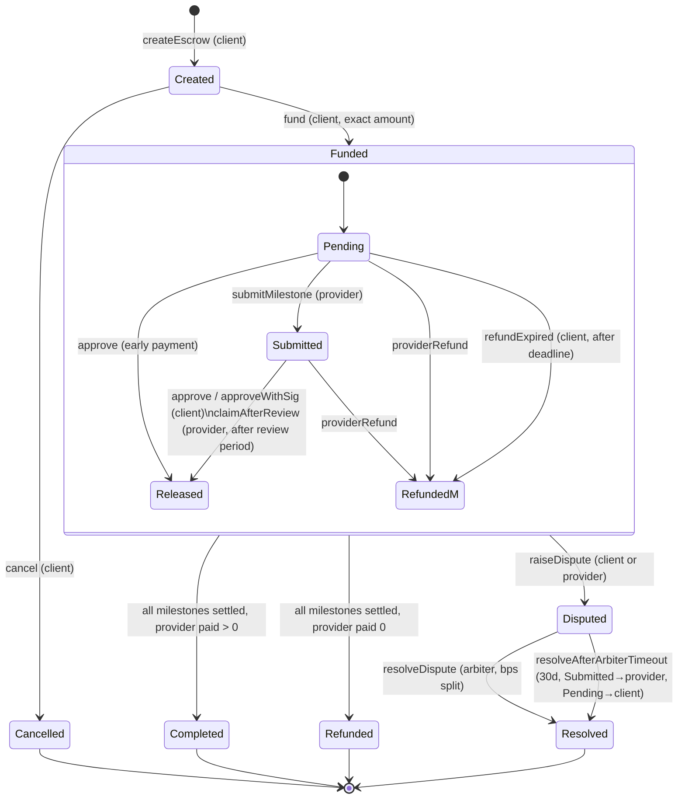

# Architecture

## Contracts
| File | Description |
|---|---|
| `src/MilestoneEscrow.sol` | Singleton escrow: many escrows keyed by `escrowId`. Inherits OZ `EIP712`, `ReentrancyGuard`, `Ownable2Step`, `Multicall`; uses `SafeERC20`, `SignatureChecker`. |
| `src/interfaces/IEscrowModule.sol` | Minimal account-facing interface for ERC-7579 executors / 4337 accounts. |
| `script/Deploy.s.sol` | Base Sepolia deploy script (env `PRIVATE_KEY`; not run). |
| `test/mocks/Mocks.sol` | MockERC20, FeeOnTransferToken, MockSmartAccount (ERC-1271 + batch), ReentrantReceiver. |

**Why a singleton rather than factory + clones?** One EIP-712 domain, one approval target for ERC-20s,
cheaper creation (~200k gas vs. clone deploy + init), a single pull-payment ledger per account across
all jobs, and one module address for smart accounts. Isolation trade-off: a bug affects all escrows;
mitigated by no upgradeability, no admin access to funds and the global solvency invariant
(`balance(token) >= liabilities[token]`).

## Storage layout (`forge inspect MilestoneEscrow storageLayout`)
| Slot | Variable | Notes |
|---|---|---|
| 0 | `_nameFallback` (EIP712) | only used if name > 31 bytes |
| 1 | `_versionFallback` (EIP712) | |
| 2 | `_owner` (Ownable) | |
| 3 | `_pendingOwner` (Ownable2Step) | |
| 4 | `nextEscrowId` | starts at 1 (0 = "no escrow") |
| 5 | `feeBps` (uint16) + `feeRecipient` (address) | packed |
| 6 | `_escrows` mapping(uint256 => Escrow) | |
| 7 | `_milestones` mapping(uint256 => Milestone[]) | |
| 8 | `_credits` mapping(address => mapping(address => uint256)) | pull-payment ledger |
| 9 | `liabilities` mapping(address => uint256) | locked + credited per token |
EIP712 name/version are immutables/ShortStrings; ReentrancyGuard (OZ 5.x) uses a namespaced/transient slot.

`Escrow` struct (7 slots): `client|feeBps|reviewPeriod|status` · `provider|deadline` · `arbiter|disputedAt` ·
`token` · `total` · `settled` · `paidToProvider`.
`Milestone` struct (1 slot): `amount uint128 | submittedAt uint64 | status uint8`.

## Accounting
* `fund`: `liabilities[token] += total`.
* release/refund/resolve: moves value from "locked" (`total - settled`) to `_credits`; liabilities unchanged.
* `withdraw`: `liabilities -= amount`, then transfer.
Invariants (tested): `balance ≥ liabilities`; `liabilities == Σ locked + Σ credits`; `settled ≤ total`; no milestone released twice.

## State diagram

All payouts become `withdrawable(account, token)` credits; `withdraw(token)` is the only outbound transfer.
