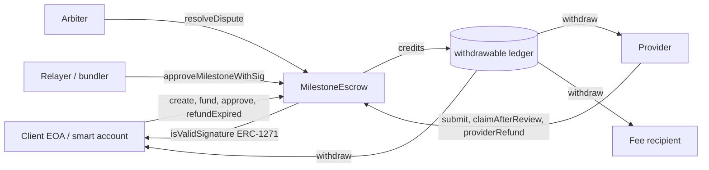
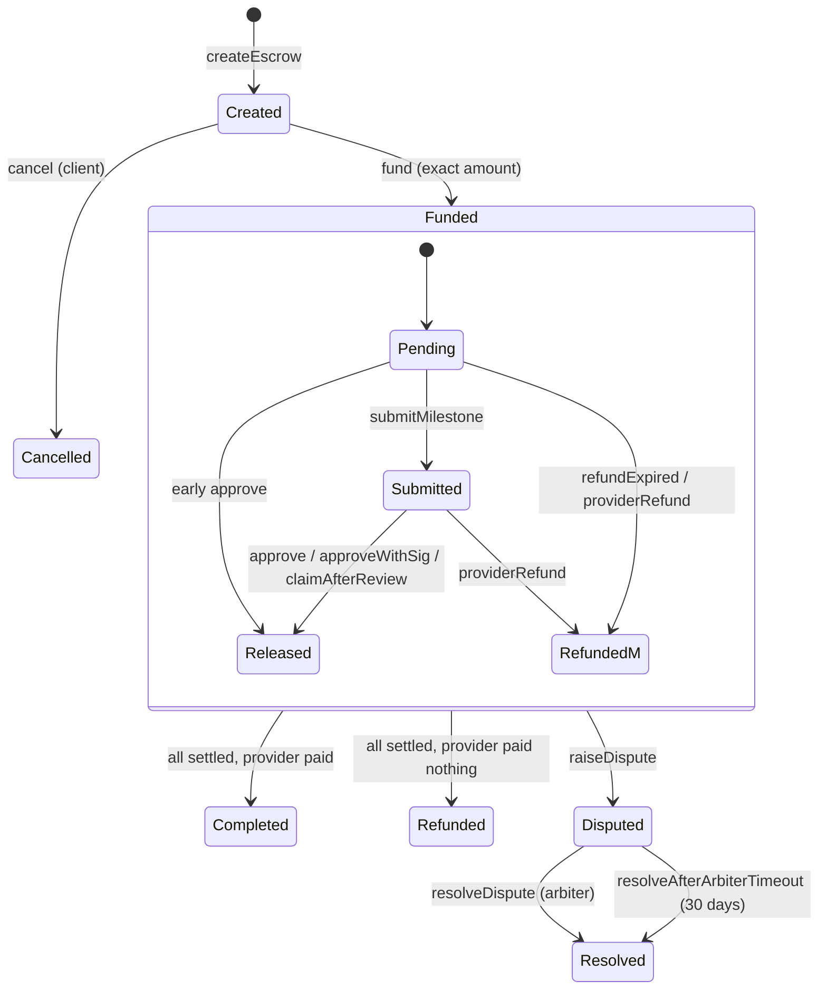

# milestone-escrow

Milestone-based escrow for freelance work, written in Solidity with Foundry.
A **client** locks payment for a job split into milestones, a **provider** is paid as each milestone
is approved, and a neutral **arbiter** settles disputes. Supports native ETH and ERC-20 tokens,
EIP-712 signed approvals (EOA and ERC-1271 smart accounts) and pull-payment withdrawals.

> ⚠️ Unaudited. Not deployed. For research / testnet use only.

## Features
- One singleton contract holds many escrows (`escrowId`), each with 1–50 milestones.
- ETH (`token == address(0)`) or ERC-20 via `SafeERC20`; fee-on-transfer tokens are rejected at funding.
- Client approves milestones directly or via an **EIP-712 signature** relayed by anyone; signatures are
  verified with OpenZeppelin `SignatureChecker` (ECDSA for EOAs, ERC-1271 for contract wallets).
- **Pull payments**: every payout is a credit; `withdraw(token)` is the only outbound transfer.
- **Timeouts** on every side: review period (provider can claim), deadline (client can reclaim unsubmitted
  work), 30-day arbiter timeout (default resolution).
- **Disputes**: the arbiter splits unsettled funds between client and provider by basis points; it cannot pay itself.
- Optional protocol fee, hard-capped at 5%, snapshotted per escrow, charged only on provider payouts.
- `Ownable2Step` admin can only change the fee for future escrows — no pause, sweep or upgrade.
- `multicall` (non-payable) and the `IEscrowModule` interface for smart-account / ERC-7579 executor integration.

## Architecture


| File | Purpose |
|---|---|
| `src/MilestoneEscrow.sol` | Escrow logic (OZ `EIP712`, `ReentrancyGuard`, `Ownable2Step`, `Multicall`, `SafeERC20`, `SignatureChecker`) |
| `src/interfaces/IEscrowModule.sol` | Thin account-facing interface for ERC-4337 / ERC-7579 accounts |
| `script/Deploy.s.sol` | Base Sepolia deployment script |
| `test/` | Unit, fuzz and invariant tests plus mocks |

Full details: [SPEC.md](SPEC.md), [ARCHITECTURE.md](ARCHITECTURE.md), [AUDIT_NOTES.md](AUDIT_NOTES.md).

## State machine


## Security model
| Threat | Mitigation |
|---|---|
| Reentrancy | `nonReentrant` on `fund`/`withdraw`, checks-effects-interactions, pull payments |
| Fee-on-transfer tokens | Balance-delta check in `fund` reverts |
| Unresponsive client | `claimAfterReview` after the review period |
| Unresponsive provider | `refundExpired` after the deadline (only unsubmitted milestones) |
| Absent arbiter | `resolveAfterArbiterTimeout` after 30 days |
| Reverting recipient | Pull payments: only blocks its own withdrawal |
| Signature replay | EIP-712 domain (chain + contract), amount binding, single-use by state, `sigDeadline` |
| Arbiter collusion | Arbiter can only split between client and provider; residual trust remains |
| Owner abuse | Fee ≤ 5%, future escrows only; no access to funds |

Known limitations: rebasing tokens are unsupported (not enforced on-chain); a token-blocklisted
recipient cannot withdraw its own credit.

## Tests and coverage
Results from running `forge test` and `forge coverage` locally (Foundry 1.8.6, solc 0.8.37):

- **35 tests passed, 0 failed** — 31 unit tests, 3 fuzz tests (512 runs each), 1 invariant suite with 3 invariants (128 runs × depth 64).
- Invariants: contract balance ≥ liabilities per token; liabilities = locked + credited; `settled ≤ total`; no milestone released twice.
- Includes an ERC-1271 mock smart-account signer test (with batched calls), a fee-on-transfer token test and a reentrancy test.
- Coverage of `src/MilestoneEscrow.sol`: **100% lines (202/202), statements (276/276), branches (60/60), functions (26/26)**.

## Static analysis (Slither 0.11.6)
- Initial run: 13 results. Fixed 6 (unindexed event address; 5 implicit-zero locals).
- Remaining 7, documented in [AUDIT_NOTES.md](AUDIT_NOTES.md): 1 false positive (`uninitialized-state` on a mapping filled via storage pointer), 5 `timestamp` (all windows ≥ 1 hour), 1 `low-level-calls` (ETH send in `withdraw`, guarded).

## Smart accounts (ERC-4337 / ERC-7579)
- Authorization uses `msg.sender` only (never `tx.origin`), so 4337 accounts, Safes and other smart wallets work as client, provider or arbiter.
- `approveMilestoneWithSig` accepts ERC-1271 signatures, so a smart-account client can approve with multisig, passkey or session-key validation, and a paymaster-backed relayer can submit it.
- Calls can be batched by the account (e.g. `createEscrow` + `fund`, or `refundExpired` + `withdraw`) or via `multicall`.
- `IEscrowModule` is the stable surface an ERC-7579 executor module could target via `executeFromExecutor`; a design sketch is in SPEC.md §10. No module contract is implemented yet.

## Build and test
```bash
git clone --recursive https://github.com/asghar002345/milestone-escrow
cd milestone-escrow
forge build
forge test
forge coverage --no-match-coverage "(test|script)/"
```
Requires solc 0.8.37 and EVM version `osaka` (OpenZeppelin 5.7 uses the `clz` opcode). Dependencies are git submodules:
forge-std v1.17.0, openzeppelin-contracts v5.7.0.

## Deploy to Base Sepolia (not yet deployed)
```bash
export PRIVATE_KEY=0x...              # never commit; .env* is gitignored
export BASE_SEPOLIA_RPC_URL=https://sepolia.base.org
export ESCROW_OWNER=0x... FEE_RECIPIENT=0x... FEE_BPS=100   # optional
forge script script/Deploy.s.sol --rpc-url base_sepolia --broadcast
```
The script refuses to run on any chain other than 84532. Confirm Base Sepolia supports the Osaka EVM version first; otherwise pin OpenZeppelin 5.4 and target `cancun`.

## Roadmap / open items
- [ ] Confirm Osaka support on Base Sepolia, then deploy and verify
- [ ] Optional capped arbiter fee on dispute resolution
- [ ] `withdrawTo(token, recipient)` for blocklisted recipients and module sweeps
- [ ] Reference ERC-7579 executor module implementing `IEscrowModule` policies
- [ ] Optional token allowlist
- [ ] External audit / formal verification

## License
MIT
